# An AI Odyssey — Architecture & Design

> A SwiftUI, multiplatform (macOS + iPadOS/iOS) personal-knowledge and AI workspace.
> Local-first data with optional iCloud sync. On-device AI on supported devices
> (Mac and supported iPhones/iPads): Apple On-Device and/or MLX.
> Remote OpenAI
> and xAI (plus other OpenAI-compatible hosts) LLMs, semantic memory/RAG, research,
> model comparison, a tool-calling agent, and Apple Mail / Gmail / Google Calendar
> integration. Documents are a basic folder of files with a single editor.

This document describes the system at the **component level**: package boundaries,
the responsibilities of each component, how data flows, and the key runtime decisions
(platform gating, iCloud availability, LLM backend selection).

---

## Table of contents

1. [System overview](#1-system-overview)
2. [Package / module structure](#2-package--module-structure)
3. [Dependency graph](#3-dependency-graph)
4. [Runtime composition (app bootstrap)](#4-runtime-composition-app-bootstrap)
5. [AnAIOdysseyCore — domain & persistence](#5-anaiodysseycore--domain--persistence)
6. [AnAIOdysseyAI — LLM, agent, research](#6-anaiodysseyai--llm-agent-research)
7. [AnAIOdysseyMail — email & Google](#7-anaiodysseymail--email--google)
8. [AnAIOdysseyUI — presentation](#8-anaiodysseyui--presentation)
9. [Data model (entities & relationships)](#9-data-model-entities--relationships)
10. [Cross-cutting concerns](#10-cross-cutting-concerns)
11. [Key sequence diagrams](#11-key-sequence-diagrams)
12. [Platform matrix](#12-platform-matrix)
13. [Known gaps / future work](#13-known-gaps--future-work)

---

## 1. System overview

An AI Odyssey is structured as a **composition root + layered Swift packages**. The app
target (`AnAIOdysseyApp`) constructs every service once and injects them into the SwiftUI
view tree via the environment. All persistent state lives in **SwiftData** (optionally
mirrored to **CloudKit**), with a separate **local SQLite** store for vector embeddings
and **iCloud key-value store** for synced settings.

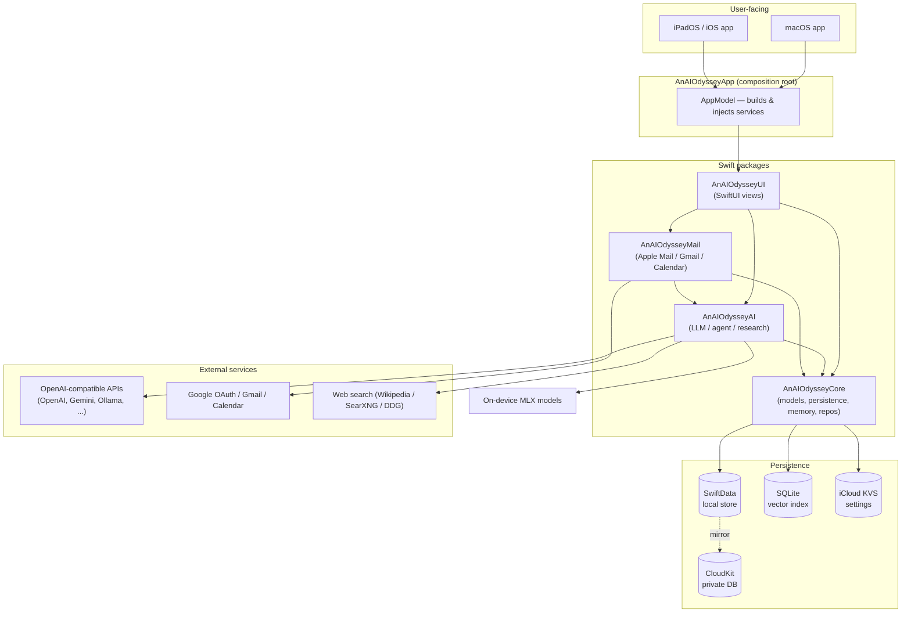

**Design principles**

- **Local-first.** Everything works offline; iCloud/CloudKit and remote LLMs are
  optional enhancements that degrade gracefully.
- **Protocol-oriented seams.** LLM, embeddings, mail reading, web search, and every
  repository are protocols, so production / mock / platform variants are swappable.
- **Composition root.** `AppModel` is the single place services are constructed and
  wired; views receive dependencies through the SwiftUI environment, never via singletons
  (except the deliberately global `CloudDefaultsSync`).
- **Fail-safe iCloud.** iCloud features are gated up front by `ICloudAvailability` because
  CloudKit / KVS abort the process (uncatchably) when entitlements or sign-in are missing.

---

## 2. Package / module structure

| Package | Target(s) | Responsibility | External deps |
|---------|-----------|----------------|---------------|
| **AnAIOdysseyCore** | `AnAIOdysseyCore` | Domain models (SwiftData), persistence/iCloud gating, repositories, semantic memory, imports, calendar/task services | None (Apple frameworks only) |
| **AnAIOdysseyAI** | `AnAIOdysseyAI`, `AnAIOdysseyMLX` | LLM abstraction & backends, provider config, tool-calling agent, research, compare, web search | `mlx-swift-lm` (MLX target only) |
| **AnAIOdysseyMail** | `AnAIOdysseyMail` | Apple Mail reading, Gmail/Calendar via Google OAuth, email AI | `AnAIOdysseyCore`, `AnAIOdysseyAI` |
| **AnAIOdysseyUI** | `AnAIOdysseyUI` | SwiftUI feature views, navigation, shared styling | `AnAIOdysseyCore`, `AnAIOdysseyAI`, `AnAIOdysseyMail` |
| **AnAIOdysseyApp** | `AnAIOdyssey` (app) | Composition root, environment injection, MLX wiring | all of the above |

The split keeps the heavy **MLX** dependency isolated in the `AnAIOdysseyMLX` target, which
is linked **only by the app**, so `AnAIOdysseyUI` and tests stay lightweight.

---

## 3. Dependency graph

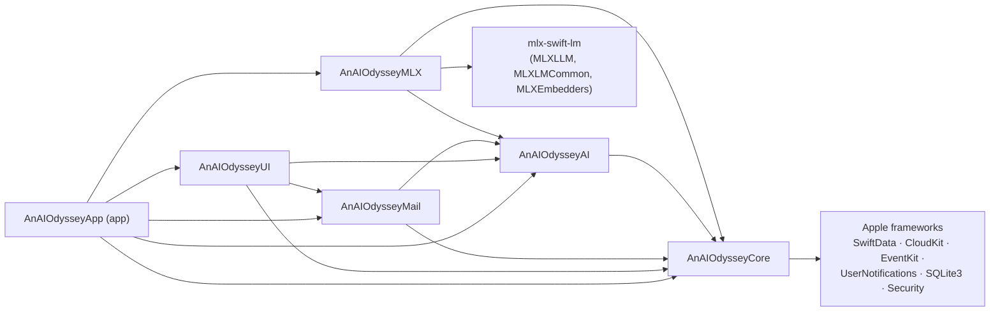

There are **no dependency cycles**: `AnAIOdysseyCore` depends on nothing internal; every
other package points "down" toward it.

---

## 4. Runtime composition (app bootstrap)

`AppModel.init()` (in `AnAIOdysseyApp/AnAIOdysseyApp.swift`) is the composition root. It runs
once, in a fixed order, because later steps depend on earlier ones (e.g. settings must be
read *after* iCloud sync has had a chance to populate `UserDefaults`).

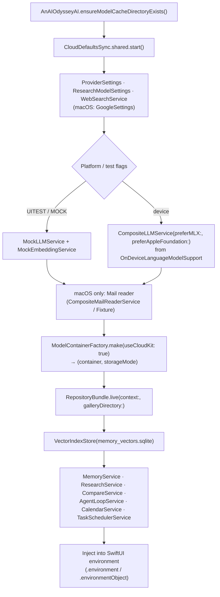

**Injection style**

- **`@Environment` keys** (defined in the owning package) for services:
  `\.repositories`, `\.llmService`, `\.memoryService`, `\.researchService`,
  `\.compareService`, `\.agentLoopService`, `\.calendarService`,
  `\.taskSchedulerService`, `\.webSearchService`, `\.mailReader`, `\.googleSettings`.
- **`@EnvironmentObject`** for user-editable, observable config:
  `ProviderSettings`, `ResearchModelSettings`, `GoogleSettings` (macOS).
- **`.modelContainer(...)`** for SwiftData access in views that use `@Environment(\.modelContext)`.

---

## 5. AnAIOdysseyCore — domain & persistence

The foundation layer. Zero internal dependencies; pure Apple frameworks.

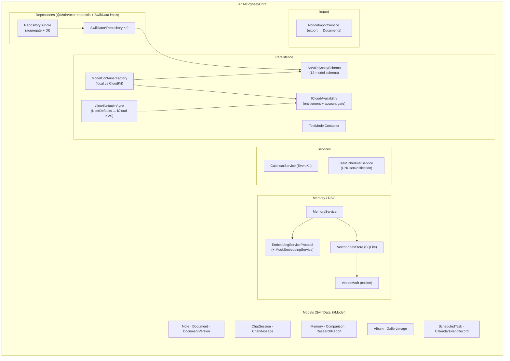

### Component responsibilities

| Component | Responsibility |
|-----------|----------------|
| **AnAIOdysseySchema** | Single source of truth listing the 12 `@Model` types; builds the `Schema`. |
| **ModelContainerFactory** | Creates the `ModelContainer`. Prefers CloudKit (`.private` of `iCloud.com.example.anaiodyssey` on macOS, `.app` suffix on iOS) when `ICloudAvailability.isAvailable`, otherwise a local store. Returns the resulting `StorageMode`. |
| **ICloudAvailability** | Pre-flight check: iCloud account present (`ubiquityIdentityToken`) **and**, on macOS, the binary actually carries the iCloud entitlement (`SecTask`). Prevents uncatchable CloudKit/KVS process aborts on unsigned/Simulator builds. |
| **CloudDefaultsSync** | Bidirectional mirror of `anaiodyssey.*` `UserDefaults` keys ↔ `NSUbiquitousKeyValueStore`. Excludes `oauthTokens` and `anaiodyssey.task.*`. Posts `didApplyRemoteChanges` so settings objects can reload. Gated by `ICloudAvailability`. |
| **RepositoryBundle** | Aggregates the 9 repositories; `live(context:)` factory; injected via `\.repositories`. |
| **SwiftData\*Repository** | One per entity. `@MainActor`, `FetchDescriptor` + `#Predicate`, ending in `context.save()`. |
| **MemoryService** | Orchestrates the dual store: SwiftData `Memory` (canonical text) + SQLite vectors (embeddings). Save/search/delete. |
| **VectorIndexStore** | SQLite-backed embedding index (`memory_vectors.sqlite`), brute-force cosine search via `VectorMath`. Kept local (not CloudKit). |
| **CalendarService** | EventKit read/write, mirrored into `CalendarEventRecord` cache. |
| **TaskSchedulerService** | Creates/pauses/resumes `ScheduledTask`s and schedules `UNUserNotification`s. |
| **NotionImportService** | One-shot importer from Notion Markdown/CSV exports. |

---

## 6. AnAIOdysseyAI — LLM, agent, research

Two targets: **AnAIOdysseyAI** (portable logic, depends only on Core) and **AnAIOdysseyMLX**
(on-device backends, depends on `mlx-swift-lm`).

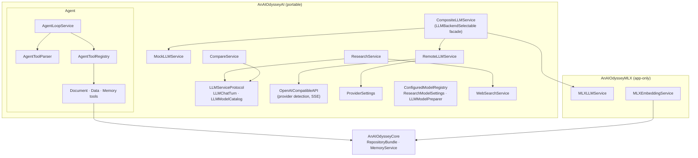

### LLM backend selection

`CompositeLLMService` implements `LLMBackendSelectable` and chooses a concrete backend at
load time, driven by `LLMBackendPreference` (`anaiodyssey.chat.backendPreference`):

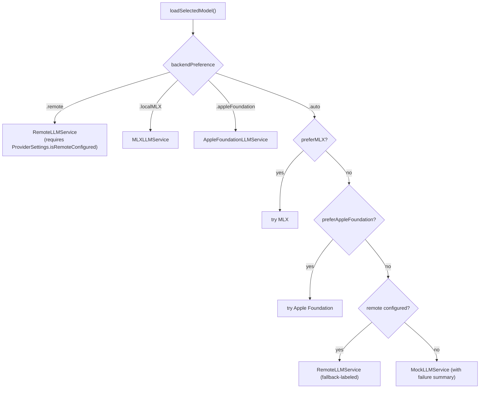

- Local backends are chosen **per device at runtime**. `preferMLX` is true when
  Metal is present, the process is not a Simulator, and a catalog model fits
  ¾ RAM. `preferAppleFoundation` is true only when
  `SystemLanguageModel.default.availability` is `.available`. Pickers still show
  **Apple On-Device** when Apple Intelligence is off (enablement copy) or the
  model is not ready (“Getting ready…”, no Download). `.deviceNotEligible`
  hides the option. Apple On-Device has no Thinking control and is suited to
  summarizing and rewriting, not a full offline chatbot. Devices with neither
  local backend hide the Local Models section. A supported device with no MLX
  download still shows Download.
- **Continue with ChatGPT** (`ChatGPTAccountService`) runs on Mac and
  iPhone/iPad. Both start a `127.0.0.1`-bound `NWListener`
  (`ChatGPTOAuthLoopback`); Mac opens the system browser, iOS shows an
  `ASWebAuthenticationSession` with no callback scheme and dismisses it when the
  listener gets `/auth/callback`. The button is the text label
  “Continue with ChatGPT” with no blossom mark. **TODO: add the official
  ChatGPT logo from OpenAI’s brand kit** — do not ship a hand-drawn
  approximation. Registers via `dynamic_agent_client` + PKCE, stores tokens in
  the Keychain (rotating refresh token saved on every refresh, single-flight),
  and sends the access token to `/v1/responses` only, with `stream: true`,
  `store: false`, full history in `input`, and none of the unsupported fields
  (`OpenAIRequestCodec.applyChatGPTPlanRequirements`). A 403
  `subscription_sharing_user_not_eligible` turns plan usage off and retries once
  on the matching API-key connection (`ProviderSettings.apiKeyFallbackConnection`).
- **Subscription plumbing** (`SubscriptionOAuth.swift`, Linux-testable):
  `OAuthTokenSet` rotation, refresh-failure classification, RFC 8628 device
  authorization, OIDC discovery, and `SubscriptionBillingPolicy` (plan error
  codes → recovery, API-key fallback). `XAISubscriptionConfig` holds the Grok
  endpoints and scopes but ships **no client id** until one is approved.
- **`OpenAICompatibleAPI`** centralizes provider quirks: detects OpenAI / xAI /
  OpenRouter / Ollama / Anthropic / Gemini, builds URLs/headers/payloads, and
  parses SSE chunks. Official OpenAI and xAI reasoning models use `/v1/responses`.

### Agent (text-based tool calling)

Official OpenAI and xAI Responses rounds use native `function_call` items and send
results back as `function_call_output` with `previous_response_id`. Other providers
still emit fenced blocks; `AgentLoopService` parses, executes against AnAIOdysseyCore,
and feeds results back as the next turn — up to `maxRounds` (default 8).

```mermaid
sequenceDiagram
    participant UI as ChatsView
    participant Loop as AgentLoopService
    participant LLM as LLMService
    participant Parse as AgentToolParser
    participant Reg as AgentToolRegistry
    participant Core as Repositories / MemoryService

    UI->>Loop: run(prompt, history, AgentContext)
    loop up to maxRounds
        Loop->>LLM: streamResponse(prompt, history)
        LLM-->>Loop: text (with ```tool blocks```)
        Loop-->>UI: .token (tool blocks stripped)
        Loop->>Parse: parseToolBlocks(text)
        alt no tool blocks
            Parse-->>Loop: []
            Loop-->>UI: .finished
        else has tool blocks
            Parse-->>Loop: [AgentToolBlock]
            Loop->>Reg: execute(block, context)
            Reg->>Core: read/write
            Core-->>Reg: result
            Reg-->>Loop: tool result
            Loop-->>UI: .toolStart / .toolResult
            Note over Loop: pendingPrompt = joined results → next round
        end
    end
```

Tool families: **Document** (`list/read/create/edit_document`), **Data**
(`list/read` notes, chats, tasks, research, calendar, gallery, comparisons), and
**Memory** (`list/search/save_memory`). All operate through `RepositoryBundle` /
`MemoryService`.

---

## 7. AnAIOdysseyMail — email & Google

macOS-first integration. Compiles on iOS but the host app only wires it on macOS.

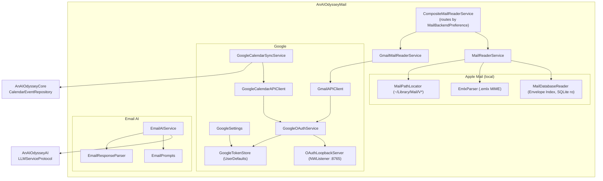

| Concern | Implementation |
|---------|----------------|
| **Local Apple Mail** | `MailReaderService` reads the **Envelope Index** SQLite (read-only) for metadata and parses `.emlx` files for bodies. Requires Full Disk Access; missing access → `permissionDenied`. |
| **Gmail** | `GmailMailReaderService` adapts the Gmail REST API to the shared `MailReaderServiceProtocol`. |
| **OAuth** | macOS: open the system browser, capture the redirect via a loopback `NWListener` on `127.0.0.1:8765`, exchange the code. iOS: not implemented — `signIn()` throws `interactiveSignInUnavailable`. |
| **Tokens** | JSON in `UserDefaults` (`anaiodyssey.google.oauthTokens`); **excluded** from iCloud sync. Auto-refresh within 60s of expiry. |
| **Calendar** | `GoogleCalendarSyncService` pulls ~90 days of events and upserts them into AnAIOdysseyCore's `CalendarEventRecord` cache (`google-{id}`). |
| **Email AI** | `EmailAIService.summarize` / `draftReply` stream from the LLM using `EmailPrompts`, then `EmailResponseParser` extracts the fenced output. |
| **Backend routing** | `MailBackendPreference` = `.automatic` (Gmail if signed in, else Apple Mail) / `.gmail` / `.appleMail`. |

---

## 8. AnAIOdysseyUI — presentation

A single SwiftUI target with one folder per feature. Views are **service/repository-centric**
(no `@Query`): they pull from environment services and refresh `@State` arrays imperatively.

```mermaid
graph TB
    subgraph UIpkg["AnAIOdysseyUI"]
        root["RootView (NavigationSplitView)"]
        section["AppSection (sidebar enum, platform-filtered)"]
        subgraph Features
            chats["Chats (agent always on + RAG)"]
            research["Research"]
            notes["Notes"]
            docs["Documents (basic folder + editor)"]
            memory["Memory (semantic search)"]
            gallery["Gallery (3-column)"]
            compare["Compare (blind voting)"]
            calendar["Calendar"]
            email["Email (macOS only)"]
            settings["Settings"]
        end
        subgraph SharedUI["Shared / Design"]
            style["MacWorkspaceStyle (layout modifiers)"]
            keyboard["MacKeyboardSupport (WorkspaceTextEditor, ChatComposerField)"]
            design["WorkspaceDesign (fonts, colors, rows)"]
            picker["WorkspaceModelPicker / WorkspaceModelSelection"]
        end
    end

    root --> section
    root --> Features
    Features --> SharedUI
    chats --> AIenv["env: llmService, memoryService, agentLoopService"]
    research --> AIenv
    compare --> AIenv
    Features --> repos["env: repositories (RepositoryBundle)"]
    email --> mailenv["env: mailReader, googleSettings (macOS)"]
```

| View | Responsibility | Primary collaborators |
|------|----------------|------------------------|
| **Chats** | Session sidebar + conversation (tool-calling agent always on); memory RAG injection | `repositories.sessions`, `llmService`, `memoryService`, `agentLoopService` |
| **Research** | Report list + streaming research with follow-ups | `researchService`, `repositories.researchReports` |
| **Notes** | Note / checklist editor with debounced saves | `repositories.notes` |
| **Documents** | Basic folder tree + single-document editor with version history | `repositories.documents` |
| **Memory** | Browse + semantic search of memories | `memoryService` |
| **Gallery** | Albums → image grid → detail; file import | `repositories.gallery` |
| **Compare** | Side-by-side model comparison + blind voting | `compareService` |
| **Calendar** | Event list/create | `calendarService` |
| **Email** *(macOS)* | Mailbox/message browser + AI summarize/reply | `mailReader`, `EmailAIService` |
| **Settings** | Storage, LLM config, imports, Google/Gemini (macOS) | `providerSettings`, `webSearchService`, import services, Google sync |

**Shared infrastructure**

- **MacWorkspaceStyle** — layout modifiers used everywhere: `workspaceFillDetailPane()`,
  `workspaceEdgeToEdgeScrollContent()`, `removeNestedSidebarToggle()`,
  `workspaceComposerBar()`, sidebar/column styles.
- **MacKeyboardSupport** — platform-native editors: `WorkspaceTextEditor` (AppKit
  `NSTextView` on macOS, `TextEditor` on iOS) and `ChatComposerField`
  (Return = send, Shift+Return = newline on macOS).
- **WorkspaceModelPicker / WorkspaceModelSelection** — a unified model dropdown that maps
  selection keys (`"<backend>|<modelID>"`) to LLM service state and research config via
  `ConfiguredModelRegistry`.

---

## 9. Data model (entities & relationships)

12 SwiftData `@Model` types. Only two use SwiftData relationships (cascade); all other
associations are **string foreign keys** for loose coupling and CloudKit friendliness.

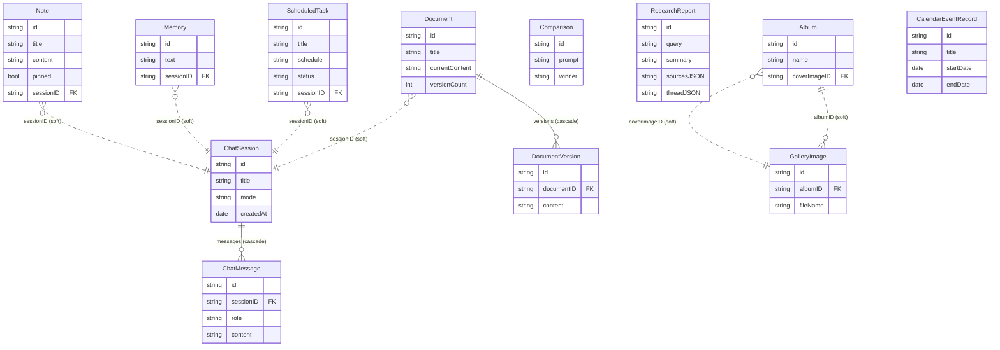

**CloudKit-compatibility rules** applied to every model (required for mirroring):

- Every stored property has a **default value**.
- To-many relationships are **optional** (`var messages: [ChatMessage]? = []`).
- Inverse sides are **optional** (`var session: ChatSession?`).
- **No `@Attribute(.unique)`** anywhere.
- Large/binary data stays **out of CloudKit**: gallery bytes on disk, embeddings in local
  SQLite. `CloudKitCompatibility.isCloudKitCompatible(text:)` guards ~900 KB string limits.

---

## 10. Cross-cutting concerns

### iCloud availability gating

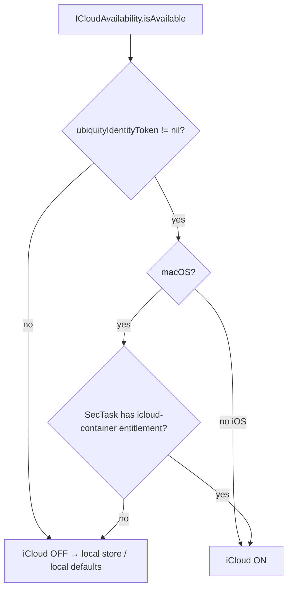

Both **CloudKit mirroring** (`ModelContainerFactory`) and **settings sync**
(`CloudDefaultsSync`) consult this single gate. The rationale: CloudKit setup and the
ubiquitous KVS communicate with system daemons over XPC and **abort the process**
(uncatchably) when entitlements/sign-in are missing — so they must be skipped entirely on
unsigned/Simulator/teamless builds.

### Settings synchronization

`UserDefaults` keys prefixed `anaiodyssey.` are mirrored to `NSUbiquitousKeyValueStore`.
Settings objects (`ProviderSettings`, `ResearchModelSettings`, `GoogleSettings`) observe
`CloudDefaultsSync.didApplyRemoteChanges` and reload their `@Published` values, so config
changes on one device appear on another. Sensitive/device-local keys (`oauthTokens`,
`anaiodyssey.task.*`) are excluded.

### Configuration keys (selected)

| Key | Owner |
|-----|-------|
| `anaiodyssey.remote.apiBaseURL` / `.apiKey` / `.model` / `.availableModels` | `ProviderSettings` |
| `anaiodyssey.chat.backendPreference` | `LLMBackendPreference` |
| `anaiodyssey.research.useChatModel` / `.modelID` / `.backend` | `ResearchModelSettings` |
| `anaiodyssey.google.oauthTokens` (local-only) | `GoogleTokenStore` |
| `anaiodyssey.task.*` (local-only) | `TaskSchedulerService` |

### Threading

Repositories, `LLMServiceProtocol`, and `EmbeddingServiceProtocol` are `@MainActor`.
Network and model work is `async`; streaming uses `AsyncStream` / `URLSession.bytes`.
The Gmail reader bridges its async client to the synchronous reader protocol via a
semaphore (`awaitSync`).

---

## 11. Key sequence diagrams

### Chat turn with memory RAG (non-agent)

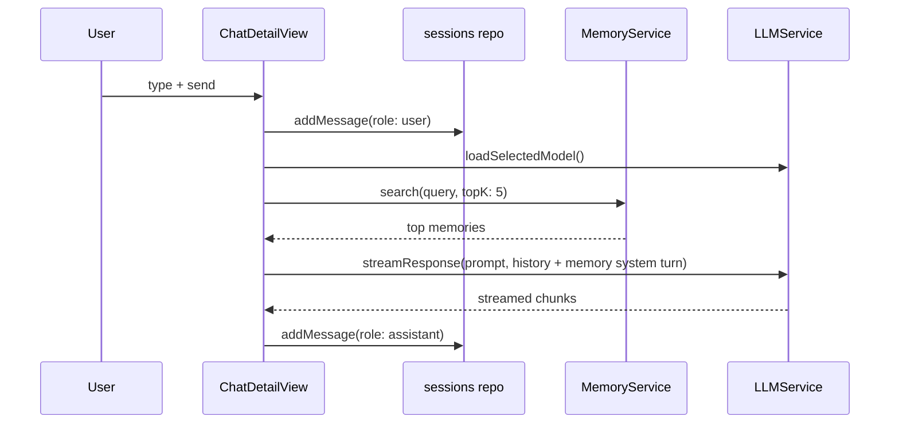

### Research run

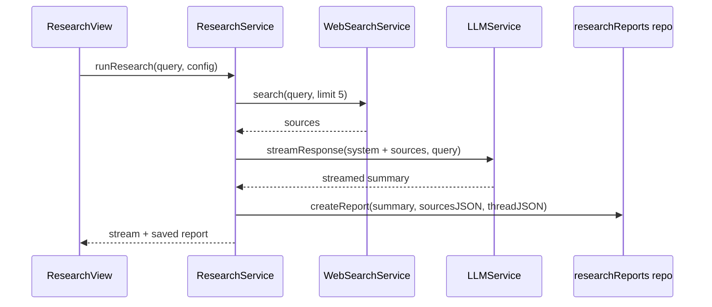

### Memory save

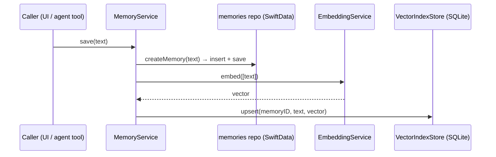

### Google Calendar sync

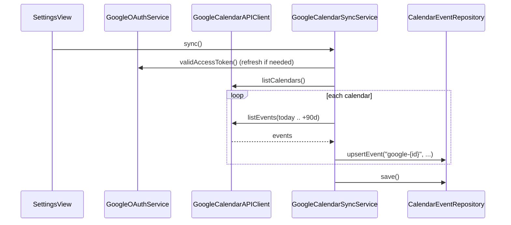

---

## 12. Platform matrix

| Capability | macOS | iPadOS / iOS |
|------------|-------|--------------|
| LLM backend default | On-device AI on supported devices (Apple On-Device and/or MLX); else Continue with ChatGPT / API key | On-device AI on supported devices; else API key. Continue with ChatGPT / API key |
| Embeddings | MLX (BGE-micro) | Mock (deterministic) |
| Apple Mail (local) | ✅ Full Disk Access | ❌ stub |
| Gmail / Google Calendar | ✅ loopback OAuth | ❌ (no `ASWebAuthenticationSession` yet) |
| Email UI | ✅ | ❌ placeholder |
| Settings location | menu-bar `Settings` scene (⌘,) | in-sidebar section |
| iCloud (CloudKit + KVS) | ✅ when signed + entitled | ✅ when signed in |

---

## 13. Known gaps / future work

- **`TasksView` is not implemented** in AnAIOdysseyUI, although `TaskSchedulerService` and the
  task repository are fully wired at the app root.
- **`ResearchModelSettings`** is injected but not directly read by any view (research uses
  `WorkspaceModelPicker` + `ProviderSettings`).
- **Agent tool parser coverage**: `AgentToolParser.toolTags` lists only 5 tool tags, while
  the registry exposes ~21 tools. Tools beyond the 5 execute when invoked directly (tests)
  but are not yet detected from free-form LLM output.
- **iOS Google sign-in** is unimplemented (`interactiveSignInUnavailable`); an
  `ASWebAuthenticationSession` flow would enable Gmail/Calendar on iPad.
- **Anthropic** is detected by `OpenAICompatibleAPI` but rejected as unsupported by
  `RemoteLLMService` (the Messages API differs from chat-completions).
- **Vector search is brute-force** (cosine over all rows); fine for personal scale, would
  need an ANN index for very large memory sets.
