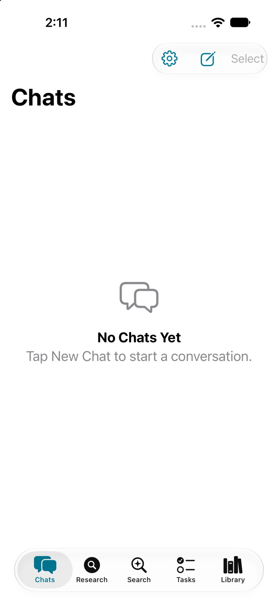
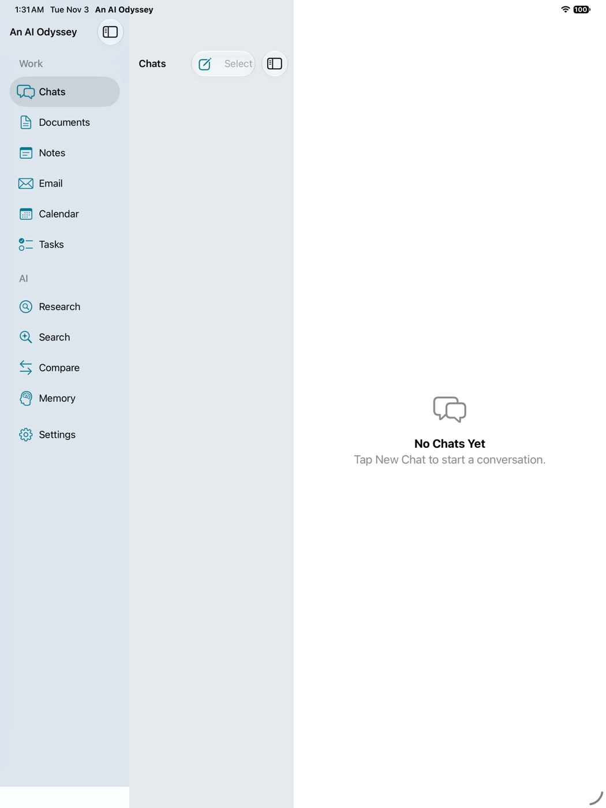
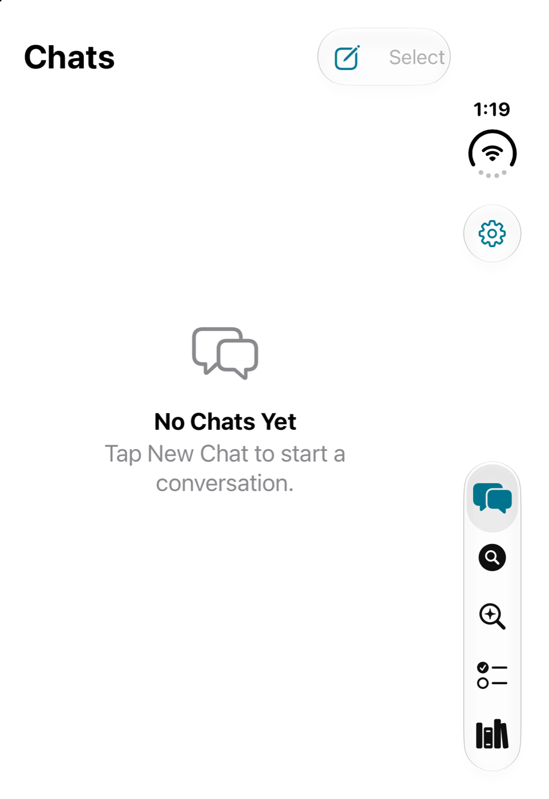
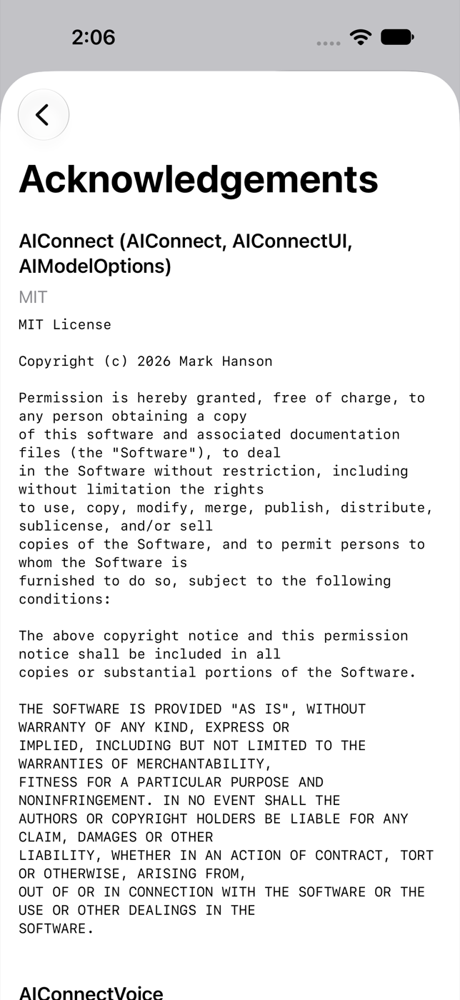
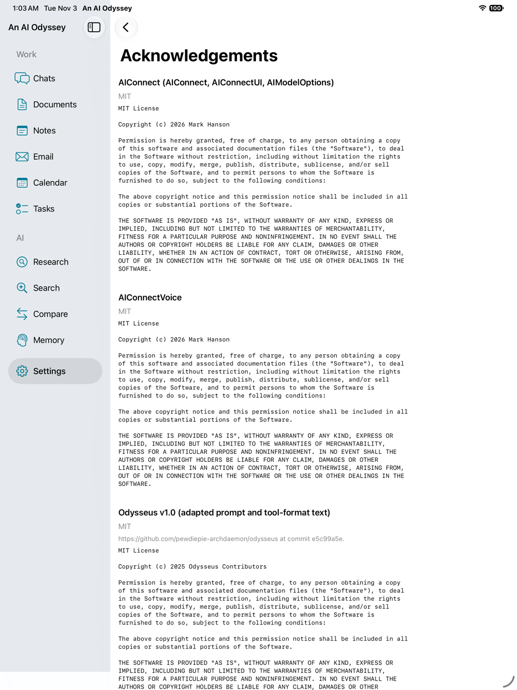

# An AI Odyssey

**An AI Odyssey** is a personal AI workspace for Mac, iPad, and iPhone by
Grey Matter Ideations. It brings chats, basic documents, notes, photos, email,
calendar, memory, research, search, and scheduled tasks together in one native
Swift/SwiftUI app, with an AI assistant that can work across all of it.

What the code supports today:

- **Your choice of models.** On-device AI on supported devices (Mac and
  supported iPhones/iPads): **Apple On-Device** on Apple Intelligence hardware
  (iPhone 15 Pro and later, including iPhone Air and the iPhone 16/17/18 lines;
  iPads with M1 or later or A17 Pro; Apple Intelligence Macs). That model is
  suited to summarizing and rewriting, not a full offline chatbot. If Apple
  Intelligence is off, the option stays and Settings says to turn it on; if the
  system model is still preparing, it shows “Getting ready…” with no Download
  button. Ineligible devices hide it. MLX Llama 3.2 1B/3B runs where there is
  Metal, you are not in the Simulator, and the model fits ¾ of RAM. Settings
  still shows Download for MLX when nothing is installed yet. Devices that
  can’t run either backend use your chosen AI provider — no Local Models
  section. First-run on iPhone/iPad leads with Apple On-Device on supported
  devices and Add API Key elsewhere. Remotes that work today: **Continue with
  ChatGPT** (Mac and iPhone/iPad; Plus/Pro plan usage with API-key fallback;
  text label only — TODO: add the official ChatGPT logo from OpenAI’s brand kit),
  **OpenAI** API keys (GPT-6 Astra, GPT-6.1 Sol, GPT-6
  Luna, GPT-5.6, plus GPT-4o) over the Responses API for reasoning and tools,
  and **xAI** (Grok 4.7 / 4.6 / 4.5 chat, `grok-imagine-image-2.0` images) at
  `https://api.x.ai/v1`. Other OpenAI-compatible hosts stay on Chat Completions.
  Spoken replies (voice) use System TTS, ElevenLabs WebSocket `/stream-input`,
  OpenAI `gpt-4o-mini-tts` (per-sentence streamed `POST /v1/audio/speech`), or
  xAI Grok TTS (`wss://api.x.ai/v1/tts`) when that provider has a key. Settings
  and Chat share a two-row picker (Voice Provider, then Voice) with friendly
  names and a play/stop preview per voice. Text is sent sentence by sentence as the
  reply generates; audio starts playing before the rest of the reply finishes.
- **Private by default.** Email and calendar stay hidden from the AI until you
  turn on access in Settings. The AI can draft mail, but sending is always a
  user tap (Gmail accounts, via OAuth).
- **One searchable workspace.** Documents (a single, basic editor), notes,
  photos, mail, chats, memories, and events are indexed for unified search.

`AnAIOdyssey` (no spaces) is the internal code name used for Swift modules,
Xcode targets, identifiers, and on-disk folders; every user-facing surface says
"An AI Odyssey".

## Requirements

- macOS 14+ / iPadOS 17+
- Xcode 16+
- [XcodeGen](https://github.com/yonaskolb/XcodeGen) (`brew install xcodegen`)

## Setup

```bash
cd AnAIOdyssey
xcodegen generate
open AnAIOdyssey.xcodeproj
```

## Build & test

```bash
# Step 1 gate (build + unit tests + iPad build + launch smoke test)
./Scripts/step1_verify.sh

# Step 2 gate (SwiftData model CRUD tests)
./Scripts/step2_verify.sh

# Step 3 gate (repository layer tests)
./Scripts/step3_verify.sh

# In-app verification gate (Steps 4-6: navigation, documents, notes, chats)
./Scripts/verify_app.sh

# Full scheme (Mac, including UI tests)
xcodebuild test -scheme AnAIOdyssey -destination 'platform=macOS'

# iPad build (Simulator — adjust device name to match your Xcode)
xcodebuild build -scheme AnAIOdyssey -destination 'platform=iOS Simulator,name=iPad (A16),OS=26.5'
```

**Signing:** The source ships with no Apple Developer team and a neutral
`com.example` bundle-ID prefix (`Config/Signing.xcconfig`). Simulator builds and
tests need nothing else. For a device or store build, copy
`Config/Local.xcconfig.example` to `Config/Local.xcconfig` (git-ignored) and set
your own `DEVELOPMENT_TEAM` and `BUNDLE_ID_PREFIX`; the bundle IDs and the
iCloud container (`iCloud.<prefix>.anaiodyssey[.app]`) follow from it.

These build commands are the ones this folder's `project.yml` and scripts describe. They were not run for the license update, and this copy has no verified standalone build.

**Live LLM tests** (`RemoteLLMIntegrationTests`) skip unless you point them at
an OpenAI-compatible server such as LM Studio:

```bash
TEST_RUNNER_ODYSSEY_LIVE_LLM_URL=http://<lan-host>:<port>/v1 \
TEST_RUNNER_ODYSSEY_LIVE_LLM_MODEL=<model-id> \
xcodebuild test -scheme AnAIOdyssey -destination 'platform=iOS Simulator,name=iPhone 18 Pro'
```

**Third-party notices:** after changing package dependencies, run
`Scripts/generate_third_party_notices.py <DerivedData>/SourcePackages/checkouts`
to refresh `ThirdPartyNotices/` (shown in Settings > About > Acknowledgements)
and `THIRD_PARTY_NOTICES.md`. A unit test fails if a resolved package is missing.

## Project layout

- `AnAIOdysseyApp/` — App entry point
- `Packages/AnAIOdysseyCore` — Models, repositories
- `Packages/AnAIOdysseyAI` — MLX inference, agent loop
- `Packages/AnAIOdysseyMail` — Apple Mail reader (macOS)
- `Packages/AnAIOdysseyUI` — Shared SwiftUI views
- `AnAIOdysseyIntegrationTests/` — Device-only MLX tests
- `AnAIOdysseyUITests/` — UI tests
- `Fixtures/` — Test fixtures
- `ThirdPartyNotices/` — License texts bundled into the app (generated)
- `../AIConnect/` — AI connection packages (MIT), a separate folder
- `../AIConnectVoice/` — Voice engine package (MIT), a separate folder

## Screenshots

Taken in the iOS 27.2 Simulator with an empty workspace (no personal data).

| iPhone | iPad | iPhone Duo |
|---|---|---|
|  |  |  |

Settings > About > Acknowledgements:

| iPhone | iPad |
|---|---|
|  |  |

## License

Copyright (C) 2026 Grey Matter Ideations. The operative grant is [LICENSE](LICENSE), copied from the live app license, including its section 7 store permission and trademark sentence. [LICENSE.appstore](LICENSE.appstore) repeats that same permission and does not add another one. The draft that named a different copyright holder is withdrawn.

This app is open source under the [GNU Affero General Public License v3.0 or later](LICENSE) (AGPL-3.0-or-later), with an additional permission under section 7 that allows distribution through Apple's App Store, Mac App Store, TestFlight and Google Play. Copyright © 2026 Grey Matter Ideations. Third-party credits are in [ACKNOWLEDGMENTS.md](ACKNOWLEDGMENTS.md).

- [`../AIConnect`](../AIConnect) (AIConnect, AIConnectUI, and `AIModelOptions/`) and [`../AIConnectVoice`](../AIConnectVoice) are MIT licensed. See each `LICENSE`. The AIConnect and AIConnectVoice copyright lines say Mark Hanson. The app license says Grey Matter Ideations. Both lines are kept as written.
- Text adapted from Odysseus v1.0 is used under the MIT License; see [ACKNOWLEDGMENTS.md](ACKNOWLEDGMENTS.md).
- Third-party packages and their licenses: [THIRD_PARTY_NOTICES.md](THIRD_PARTY_NOTICES.md). That file matches `AnAIOdyssey.xcodeproj/project.xcworkspace/xcshareddata/swiftpm/Package.resolved`. The `Package.resolved` files under `Packages/AnAIOdysseyAI`, `Packages/AnAIOdysseyMail`, and `Packages/AnAIOdysseyUI` pin older versions and extra packages. See the repository root README. Neither lockfile was rewritten here.

### Trademarks

The app name ("An AI Odyssey") and icon are trademarks of Grey Matter
Ideations and are not licensed under the AGPL. Forks must use a different name
and icon. Official store builds are free and built from tagged source in this
repository.

The store permission in LICENSE also says: "This permission does not grant any rights in the name or icon of An AI Odyssey or any other trademark of Grey Matter Ideations."

This new repository has no commits and no tags yet. The tagged-source sentence above is the existing trademark wording. It is not a claim that a tag exists here.

### Signing credentials

Signing credentials (team ID, certificates, provisioning profiles and API keys)
are not part of the source. Supply your own to build and distribute.
